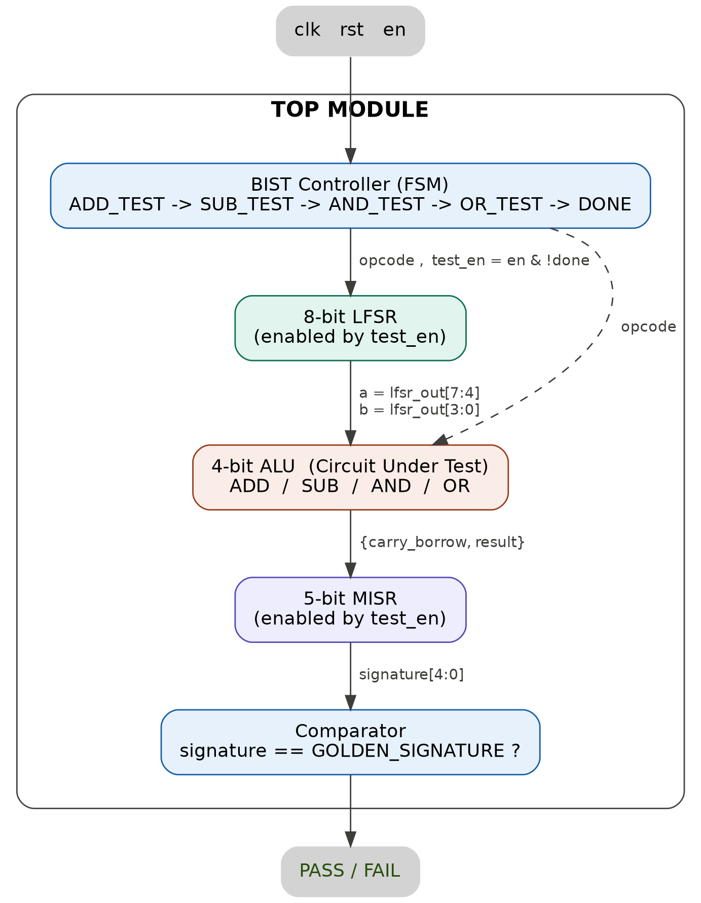
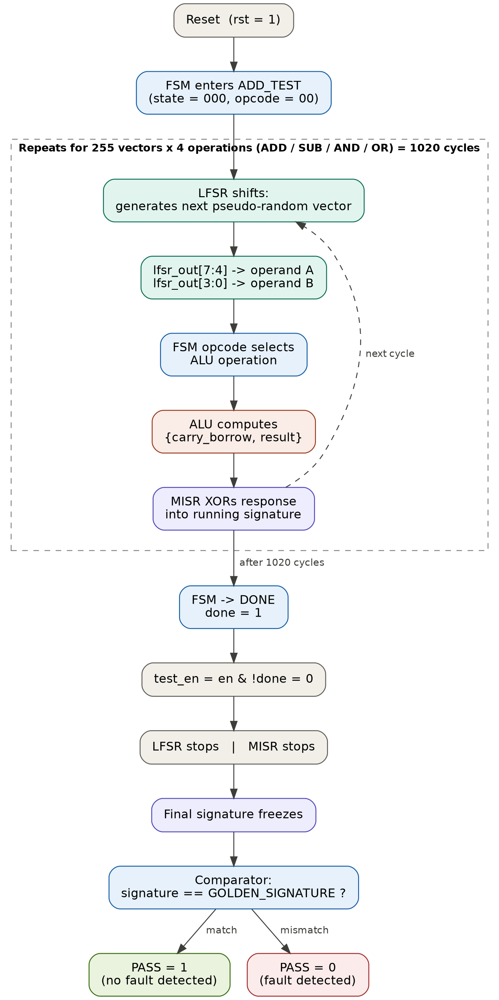
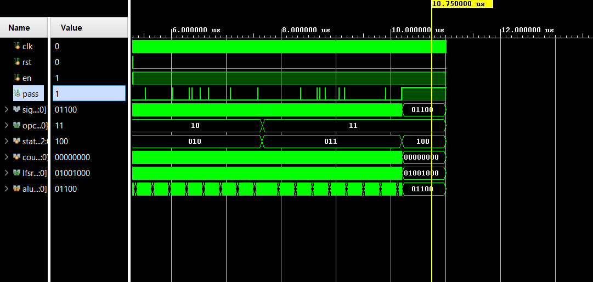
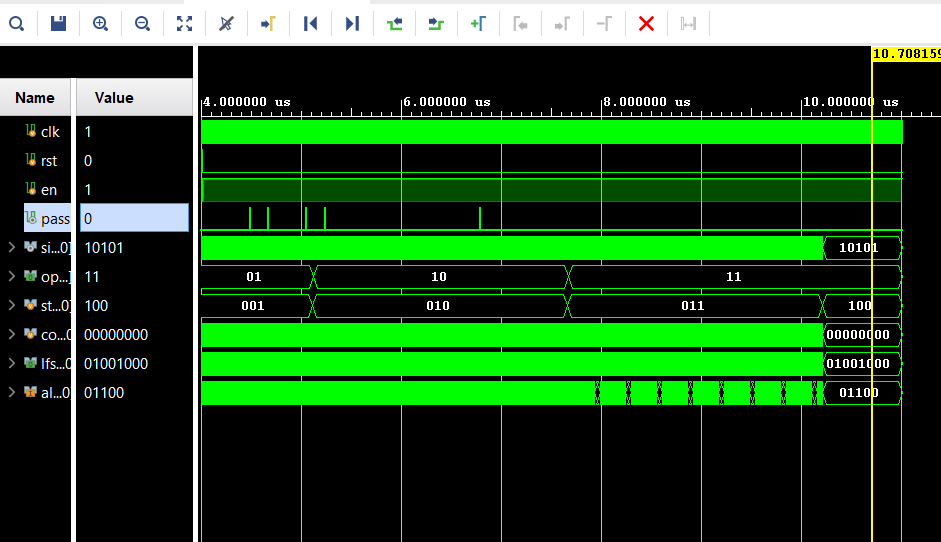
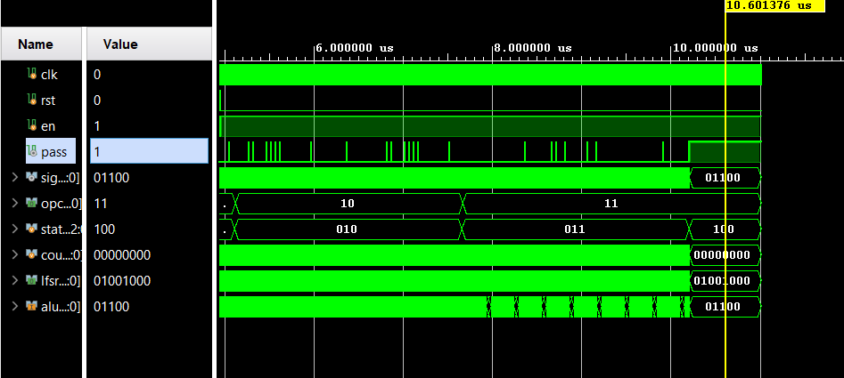

# Built-In Self-Test (BIST) for a 4-bit ALU Using Verilog HDL


## Overview

This project implements a **Built-In Self-Test (BIST)** architecture for a **4-bit Arithmetic Logic Unit (ALU)** using **Verilog HDL**. The BIST system automatically generates pseudo-random test vectors, applies them to the ALU, compresses the output responses into a compact signature, and compares the generated signature with a reference signature to determine whether the ALU is functioning correctly.

The project demonstrates the complete BIST flow including **pseudo-random test generation, response compaction, fault detection, and signature aliasing**.

---

# Project Highlights

- Designed a modular **4-bit ALU** supporting **ADD, SUB, AND, and OR** operations.
- Implemented an **8-bit Linear Feedback Shift Register (LFSR)** for pseudo-random test vector generation.
- Designed a **5-bit Multiple Input Signature Register (MISR)** for response compaction.
- Developed an **FSM-based BIST controller** to automate the testing sequence.
- Implemented automatic **PASS/FAIL** detection using signature comparison.
- Demonstrated **fault detection** by intentionally modifying the ALU logic.
- Demonstrated **signature aliasing**, a known limitation of MISR-based BIST.
- Verified the complete design using **Xilinx Vivado Simulator**.

---

# BIST Architecture

<p align="center">

</p>

---

# Data Flow

<p align="center">

</p>

---

# Project Structure

```text
BIST-ALU-SELF-TEST
│
├── rtl
│   ├── alu.v
│   ├── comparator.v
│   ├── fsm.v
│   ├── lfsr.v
│   ├── misr.v
│   └── top.v
│
├── testbench
│   ├── alu_tb.v
│   ├── fsm_tb.v
│   ├── lfsr_tb.v
│   ├── misr_tb.v
│   └── top_tb.v
│
├── screenshots
│   ├── architecture.png
│   ├── dataflow.png
│   ├── correct_output.png
│   ├── induced_fault.png
│   └── aliased_fault.png
│
├── report
│   └── BIST_ALU_Report.pdf
│
├── README.md
└── .gitignore
```

---

# Design Modules

### ALU
Implements four 4-bit arithmetic and logical operations:
- Addition
- Subtraction
- Bitwise AND
- Bitwise OR

### LFSR
Generates pseudo-random input vectors for testing the ALU.

### FSM Controller
Sequences the BIST process through the ADD, SUB, AND, and OR test phases before completing the self-test.

### MISR
Compresses the ALU outputs into a 5-bit signature using response compaction.

### Comparator
Compares the generated MISR signature with the expected reference signature and generates the **PASS/FAIL** signal.

---

# Test Summary

| Test Case | Expected Result | Outcome |
|-----------|-----------------|---------|
| Correct ALU | PASS | ✅ PASS |
| Injected Fault | FAIL | ✅ Fault Detected |
| Signature Aliasing | PASS (Aliasing) | ✅ Demonstrated |

---

# Simulation Results

## Correct ALU Operation

The generated MISR signature matches the expected reference signature, indicating successful verification.

**PASS = 1**

<p align="center">

</p>

---

## Fault Detection

A fault was intentionally introduced into the ALU implementation by modifying one of the logic operations. The generated MISR signature no longer matches the expected reference signature, and the comparator correctly reports:

**PASS = 0**

<p align="center">

</p>

---

## Signature Aliasing

This project also demonstrates **signature aliasing**, where a faulty ALU implementation produces the same compressed MISR signature as the fault-free implementation. As a result, the comparator incorrectly reports:

**PASS = 1**

This illustrates a well-known limitation of MISR-based Built-In Self-Test architectures.

<p align="center">

</p>

---

# Tools Used

- Verilog HDL
- Xilinx Vivado
- Vivado Simulator

---

# Concepts Demonstrated

- Built-In Self-Test (BIST)
- Linear Feedback Shift Register (LFSR)
- Multiple Input Signature Register (MISR)
- Finite State Machine (FSM)
- Signature Analysis
- Fault Detection
- Signature Aliasing
- RTL Design
- Digital Circuit Verification

---

# Future Improvements

- Extend the design to support **8-bit and 16-bit ALUs**.
- Reduce aliasing probability using larger MISRs.
- Generate reference signatures automatically.
- Implement the design on an FPGA development board.
- Add support for additional ALU operations.

---

# Author

**Sooryanarayan S**

B.Tech in Electronics and Communication Engineering

National Institute of Technology Calicut
